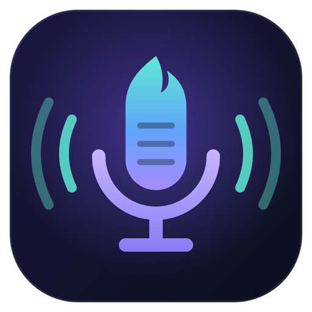

<p align="center">
  
</p>

<h1 align="center">LocalWisp</h1>

<p align="center">
  <b>Push-to-talk voice dictation that runs entirely on your PC.</b><br>
  Hold a key, speak, release — your words are typed into whatever app has focus.
</p>

<p align="center">
  
  
  
  
</p>

---

LocalWisp is a tiny, private alternative to cloud dictation tools. It uses
[faster-whisper](https://github.com/SYSTRAN/faster-whisper) (OpenAI's Whisper
running on CTranslate2) to transcribe your voice **locally** — on your NVIDIA GPU
if you have one, on the CPU otherwise — and pastes the text where your cursor is.
Your audio never leaves your computer.

## Features

- 🎙️ **Push-to-talk** — hold `Ctrl` + `Win` to record, release to type. The mic is only open while you hold the keys.
- 🔒 **100% local** — no accounts, no API keys, no audio uploaded anywhere.
- ⚡ **GPU accelerated** — CUDA with `float16` when available, automatic fallback to CPU (`int8`).
- 🌍 **Any language Whisper supports** — Spanish by default, or let it auto-detect.
- ✍️ **Types anywhere** — editors, browsers, chat apps, terminals… it pastes through the clipboard (and then restores what you had copied), so accents and symbols always come out right.
- 🟢 **Tiny on-screen indicator** above the taskbar shows what it is doing:

<p align="center">
  
  <br><sub>Idle · Recording · Transcribing</sub>
</p>

## Requirements

- Windows 10 / 11
- [Python 3.9+](https://www.python.org/downloads/) (tick *"Add python.exe to PATH"* when installing)
- A microphone
- Optional: an NVIDIA GPU for fast transcription (no system-wide CUDA install needed)

## Installation

```bash
git clone https://github.com/chmolto/localwisp.git
cd localwisp
install.bat
```

`install.bat` installs the Python dependencies and, if it finds an NVIDIA GPU, the
CUDA libraries from [`requirements-gpu.txt`](requirements-gpu.txt). Prefer doing it by hand?

```bash
pip install -r requirements.txt
pip install -r requirements-gpu.txt   # optional, NVIDIA GPUs only
```

Optionally, create a desktop shortcut with the LocalWisp icon:

```powershell
powershell -ExecutionPolicy Bypass -File create-shortcut.ps1
```

## Usage

Double-click **`run.bat`** (or the desktop shortcut). The first launch downloads the
Whisper model, which can take a few minutes; after that it starts in seconds.

1. Put the cursor where you want the text.
2. Hold **`Ctrl` + `Win`** and speak.
3. Release — the text appears.

Right-click the indicator to quit.

> **Why does `run.bat` ask for administrator rights?** Windows does not let a normal
> program see key presses inside apps running as administrator. Running LocalWisp
> elevated makes the hotkey work everywhere. You can also run it without elevation:
> `pythonw localwisp.py`.

## Configuration

All options can be passed on the command line:

```bash
python localwisp.py --model small --language en --hotkey f9
```

| Option       | Default             | Description |
|--------------|---------------------|-------------|
| `--hotkey`   | `ctrl+left windows` | Keys to hold, joined with `+` (e.g. `f9`, `ctrl+alt`). |
| `--model`    | `medium`            | Whisper model: `tiny`, `base`, `small`, `medium`, `large-v3`, `turbo`… |
| `--language` | `es`                | Spoken language as an ISO code (`en`, `es`, `de`…) or `auto`. |
| `--device`   | `auto`              | `auto` (GPU if available), `cuda` or `cpu`. |

To make your options permanent, edit the `LOCALWISP_ARGS` line at the top of `run.bat`.

**Choosing a model:** smaller models (`tiny`, `base`, `small`) are faster and lighter but
make more mistakes; `medium` is a good balance on a GPU; `large-v3` is the most accurate;
`turbo` is close to `large-v3` and much faster. On CPU only, start with `small`.

## Privacy

- Audio is recorded only while the hotkey is held, kept in memory, and discarded after transcription.
- Transcription runs on your machine. The only network access is the one-time model download from Hugging Face.
- The keyboard hook listens **only to the hotkey's own keys** — LocalWisp never records what you type.

## Troubleshooting

- **"GPU not available, falling back to CPU"** — install the CUDA libraries with
  `pip install -r requirements-gpu.txt` and make sure your NVIDIA driver is up to date.
- **Nothing is typed** — check the indicator turns red while you hold the keys. If it
  doesn't, try another hotkey (`--hotkey f9`) or run `run.bat` as administrator.
- **Wrong language / poor accuracy** — set `--language` explicitly and try a bigger model.
- **See what's going on** — run `python localwisp.py` from a terminal instead of `run.bat` to get the log.

## Credits

Built on [faster-whisper](https://github.com/SYSTRAN/faster-whisper) and
[OpenAI Whisper](https://github.com/openai/whisper).

## License

[MIT](LICENSE) © Christian Moltó
